<h1 align="center">Raspberry Pi Homelab</h1>

<p align="center">
  Self-hosted services on a single Raspberry Pi, reachable only over Tailscale.
</p>

<p align="center">
  
  
  
  
  
</p>

<p align="center">
  <picture>
    <source media="(prefers-color-scheme: dark)" srcset="docs/assets/architecture-dark.svg" />
    
  </picture>
</p>

## Highlights

- **Docker Compose, two Environments.** `pro` is always on; `dev` starts on
  demand to try a change and stops afterwards. Same services, separate data.
- **Tailscale only.** Every port binds to `127.0.0.1`; the host's tailscaled
  serves `pro` as Tailscale Services at `https://<service>.<tailnet>.ts.net`.
- **Secrets at deploy time.** Pulled from GCP Secret Manager by `just deploy`,
  never polled, never committed.
- **Per-service backups.** Backrest runs restic plans to Backblaze B2 and
  alerts through ntfy when one fails.
- **Memory guards.** Every container has a `mem_limit`, and systemd-oomd
  keeps the Pi responsive under pressure.

## Services

| Service                                          | What it is                         | pro URL                                 |
| ------------------------------------------------ | ---------------------------------- | --------------------------------------- |
| [Homepage](https://gethomepage.dev)              | Dashboard for everything below     | `https://home.<tailnet>.ts.net`          |
| [Vaultwarden](https://github.com/dani-garcia/vaultwarden) | Bitwarden-compatible password manager | `https://vaultwarden.<tailnet>.ts.net` |
| [Tandem](https://github.com/vieitesss/tandem)    | Expense-splitting app (web + API)  | `https://tandem.<tailnet>.ts.net`        |
| [Forgejo](https://forgejo.org)                   | Git forge (HTTPS + SSH)            | `https://forgejo.<tailnet>.ts.net`       |
| [Glances](https://nicolargo.github.io/glances/)  | Host monitoring                    | `https://glances.<tailnet>.ts.net`       |
| [Backrest](https://github.com/garethgeorge/backrest) | restic backups to Backblaze B2 | `https://backrest.<tailnet>.ts.net`      |

`<tailnet>.ts.net` is the tailnet's DNS name, set as `TAILNET_DOMAIN` in `.env`. Data lives under
`/srv/rpi/<env>/<service>`.

## Quick start

On the Pi, from a checkout of this repo:

```bash
just deploy dev            # try a change
just dev-down              # stop dev; its data stays
just dev-seed vaultwarden  # replace dev data with the latest pro snapshot
git pull && just deploy pro
just compose pro logs -f home
```

Run `just` to list every recipe.

### Releasing an image

1. Set the new tag in `compose/dev.yaml` and `just deploy dev`.
2. Once it works, copy the same tag into `compose/pro.yaml`.
3. Push, then `git pull && just deploy pro` on the Pi.

## Running it on your own tailnet

Everything host-specific lives in the untracked `.env`:

1. **Configure.** `cp .env.example .env` and fill in your tailnet domain, the
   Pi's machine name, GCP project, B2 bucket and (optionally) ntfy topic.
   `just` loads it for every recipe.
2. **Join the Pi to the tailnet** with the `tag:rpi` tag.
3. **Allow access.** Add grants for the Services to your tailnet policy:
   `just tailnet-policy pull <dir>`, edit `<dir>/policy.new.hujson`, then
   `just tailnet-policy push <dir>`.
4. **Create the Services** (`svc:vaultwarden`, `svc:tandem`, …):
   `just tailnet-policy services`. Both recipes ask for a short-lived
   Tailscale API access token.
5. **Serve them from the host:** `just tailnet-serve`. It runs once per
   change, and tailscaled keeps the config across reboots. The first TLS
   certificate for each Service can take about a minute.
6. **Provide the secrets.** Create the secrets listed in
   [`docs/security.md`](./docs/security.md) in your GCP project's Secret
   Manager.
7. **Deploy:** `just deploy pro`.

## Repository layout

```text
compose/
├── compose.yaml        # every service, shared by both Environments
├── pro.yaml            # pro overlay: pinned tags, ports, pro-only services
├── dev.yaml            # dev overlay: candidate tags, ports, seed restic
├── backrest/           # repo and plan template merged on deploy
└── home/               # Homepage config
scripts/                # deploy, secrets, dev seeding, Tailscale serve and policy
system/                 # host-level systemd and apt configuration
docs/                   # security notes, ADRs, diagram assets
```

## Prerequisites

- Docker with the Compose plugin, `just`, `gcloud` (authenticated), `python3`
- Tailscale on the host, tagged `tag:rpi`
- `.env` at the repo root, from [`.env.example`](./.env.example)

## Documentation

| Doc                                          | Covers                                  |
| -------------------------------------------- | --------------------------------------- |
| [`AGENTS.md`](./AGENTS.md)                   | Conventions, workflow, operational notes |
| [`GLOSSARY.md`](./GLOSSARY.md)               | Project glossary                        |
| [`docs/security.md`](./docs/security.md)     | Secrets and network exposure            |
| [`docs/adr/`](./docs/adr)                    | Design records                          |
| [`system/README.md`](./system/README.md)     | Host-level configuration                |

The diagram source is
[`docs/assets/architecture.archify.json`](./docs/assets/architecture.archify.json),
rendered with [Archify](https://github.com/tt-a1i/archify) and exported as the
light and dark SVGs above.
